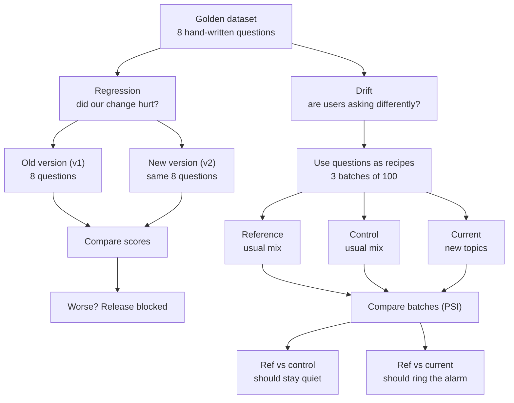

# MediDesk — Design Discussion Notes

Notes from the design discussion (1–5 Oct 2026) that shaped the proposal.
The proposal itself is in [MediDesk_Use_Case_Proposal.md](MediDesk_Use_Case_Proposal.md).

- [1. Why this use case](#1-why-this-use-case)
- [2. Regression vs drift, in plain words](#2-regression-vs-drift-in-plain-words)
- [3. Reusing the HR project structure](#3-reusing-the-hr-project-structure)
- [4. Vector store and chunking](#4-vector-store-and-chunking)
- [5. FAISS vs Postgres](#5-faiss-vs-postgres)
- [6. MCP: when and how](#6-mcp-when-and-how)
- [7. Lecturer Q&A](#7-lecturer-qa)
- [8. Wiring FastAPI and ADK](#8-wiring-fastapi-and-adk)
- [9. Open items and corrections](#9-open-items-and-corrections)

---

## 1. Why this use case

Same shape as the HR RBAC assistant (Module 4), different domain. The HR
project restricts executive pay; MediDesk restricts patient medical records.
The PII risk is easier for a class to grasp, and every eval lane maps
one-to-one.

| HR project | MediDesk |
|---|---|
| `[VISIBILITY: PUBLIC / ADMIN]` | `[VISIBILITY: PUBLIC / CLINICAL]` |
| roles `employee` / `admin` | `front_desk` / `clinician` |
| `/ask`, `/admin/ask` | `/ask`, `/clinical/ask` |
| `retrieve_public_policy`, `retrieve_admin_compensation` | `retrieve_clinic_policy`, `retrieve_patient_record` |
| `rbac_denial` evalset | `clinical_denial` evalset (expects an empty tool trajectory) |

"Prod-ready" for a one-day build means the practices, not the scale:
two-layer security, one shared config, audit log, `.env.example`, pinned
dependencies, a CI gate and a README with the architecture.

## 2. Regression vs drift, in plain words

- **Regression** asks whether *we* changed something for the worse. The data
  stays fixed (golden set, attack set, evalsets) and the system changes
  (v1 → v2). The golden set works like a **fixed exam**.
- **Drift** asks whether *our users* changed. The system stays fixed and the
  data changes (reference window → current window). The golden set works like
  a **recipe book**: its questions seed templates that generate 100-question
  batches.



- The golden set can't be the drift windows itself: 8 questions is too few
  for PSI (about 5–10 per bucket are needed), and it is a curated test set,
  not traffic.
- The **control** window is a second normal week. If PSI fires on it, the
  thresholds are too jumpy.
- **New reference:** after a drift alert is reviewed and the knowledge base
  updated, the current window becomes the new reference. The regression
  baseline is replaced only by the next approved release.

## 3. Reusing the HR project structure

Only the structure and plumbing are reused; all HR content is rewritten for
the clinic. Legend used in the README: `=` copied unchanged, `~` same role
with clinic content, `+` new.

Copied unchanged: `backend/llm.py` (Groq key failover),
`tests/quality/groq_judge.py` (cached judge), `pytest.ini`,
`requirements*.txt`, `evalsets/*_config.json`. Adapted: `tests/conftest.py`
(roles, app marker).

"Drop the concept-drift labelled sample first" means: input and output drift
only compare numbers between batches and need no answers. Concept drift also
needs about 10 hand-labelled questions scored by the LLM judge, so it is the
slowest part and uses the daily LLM budget.

## 4. Vector store and chunking

Already in the HR project and reused as-is in shape:

```
knowledge.txt
   │  split by [VISIBILITY: ...] markers, then by "## " headings
   ▼
chunks (RecursiveCharacterTextSplitter: 500 characters, 100 overlap)
   │  each chunk keeps its label → {"text": ..., "visibility": "clinical"}
   ▼
embed with local MiniLM (no API calls)
   ▼
data/faiss/index.faiss + chunks.json
   ▼
search(question, role): fetch TOP_K × OVERFETCH (5 × 6) candidates, drop forbidden ones
```

FAISS is a file-based vector index, not a database server. That is fine at
this size.

## 5. FAISS vs Postgres

FAISS isn't required. Vector search is needed because users word things
differently from the documents ("kid's jab card" should match the vaccination
policy).

| | FAISS (now) | Postgres + pgvector |
|---|---|---|
| Setup | None; files on disk | Postgres server (Docker), ~1 h |
| Role filter | Over-fetch, then filter in Python | `WHERE visibility = ANY(:allowed)` in the query |
| DB-level security | None | Row-level security per connection role |
| Patient records | Text chunks | A real table, exact lookup by ID |

Weakness this exposes in the current design: filtering *after* the search
means that if most top candidates are clinical, a front-desk user gets few or
no policy chunks back. That is a quality bug, not a leak. Filtering inside
the query avoids it.

Recommended production path: pgvector with row-level security for policy
text; patient records as a normal table looked up by exact ID; RAG for policy
only. For the one-day build, keep FAISS.

## 6. MCP: when and how

RAG is how you *find* text. MCP is how an agent *connects* to a tool or data
source through a separate server. They are not alternatives: an MCP server
can have the RAG pipeline inside it.

Use MCP when several clients need the same tools, when the data belongs to
another system (appointments, patient records), or when you want the server
itself to enforce access. Skip it for a single app with fixed knowledge.

Patient lookup by ID is a lookup, not a search, so it fits MCP well. The one
rule: the role check lives **inside the MCP server**, and the role comes from
the connection (environment variable or auth header), never from a tool
argument the model fills in.

Sketch (not tested):

```python
# mcp_server/clinic_server.py
import os
from mcp.server.fastmcp import FastMCP
from backend.rag_pipeline import RAGPipeline

ROLE = os.environ["MEDIDESK_ROLE"]          # set by the client at launch, not by the LLM
rag = RAGPipeline()
mcp = FastMCP("medidesk")

@mcp.tool()
def search_clinic_policy(query: str) -> str:
    """Clinic hours, insurance, cancellation and vaccine policy."""
    return "\n\n".join(r["chunk"] for r in rag.search(query, role=ROLE))

@mcp.tool()
def get_patient_record(patient_id: str) -> str:
    """One patient's record. Clinicians only."""
    if ROLE != "clinician":
        raise PermissionError("Not authorised for patient records")
    return "\n\n".join(r["chunk"] for r in rag.search(f"patient {patient_id}", role=ROLE))

if __name__ == "__main__":
    mcp.run()
```

The ADK agent connects with `McpToolset` (stdio), passing
`env={"MEDIDESK_ROLE": role}` and a `tool_filter` that hides the patient tool
from front desk. Treat MCP as an optional stretch goal (about 1–1.5 h).

## 7. Lecturer Q&A

**Q: How do you use both RAG and ADK?**

> RAG is how the assistant finds the right information. ADK is how it
> decides what to do with a question. The RAG search is wrapped as ADK tools,
> so the agent chooses which knowledge source to search, and the retrieval
> layer decides what that role is allowed to see.

Analogy: RAG is the library, ADK is the librarian, the role filter is the
locked room. Two separate tools give ADK's eval something to test: the tool
trajectory proves the agent never even tried to open patient records.

Possible follow-up: in the HR agent, `retrieve_admin_compensation` hard-codes
`role="admin"`, so on the ADK path safety depends on the model choosing not
to call it (which the trajectory eval checks). MediDesk builds the agent per
role, so the front-desk agent doesn't have the patient tool at all.

**Q: How do you implement FastAPI and ADK, and connect them?**

> FastAPI is the front door and ADK is the brain. FastAPI checks the API key
> and works out the role, then hands the question to an ADK agent built for
> that role, which calls the RAG tools. Security happens at the door, before
> the agent runs.

See section 8 for the code.

**Q: Isn't FastAPI just for triggering test endpoints, and ADK the client UI?**

Partly right: FastAPI's `/docs` page and `adk web` both look like front ends,
but both are developer tools.

> FastAPI is the production API: it checks the API key, decides the role,
> and runs the ADK agent behind it. ADK is the reasoning layer that picks
> which RAG tool to call. Clients use the MediDesk web app, which talks only
> to FastAPI. ADK's web chat is for debugging and demos only, because it
> bypasses the role check and the audit log.

**Q: Why MCP instead of the RAG pipeline?** See section 6.
**Q: Why FAISS and not Postgres?** See section 5.

## 8. Wiring FastAPI and ADK

```
Client ──X-API-Key──► FastAPI /ask
                        │ resolve_role(key) → front_desk / clinician  (401/403 here)
                        ▼
                     ADK Runner ──► Agent(tools = only what this role may use)
                        │              └─ retrieve_clinic_policy → RAG search(role)
                        │              └─ retrieve_patient_record → clinician only
                        ▼
                     answer + tools called ──► audit log ──► JSON response
```

Sketch (not tested; check ADK method names against the pinned
`google-adk==2.9.1` before relying on it):

```python
# medidesk_agent/agent.py
def build_agent(role: str) -> Agent:
    def retrieve_clinic_policy(query: str) -> dict:
        """Clinic hours, cancellations, insurance and vaccinations."""
        return {"passages": [r["chunk"] for r in _rag.search(query, role=role)]}

    def retrieve_patient_record(query: str) -> dict:
        """One named patient's record. Clinicians only."""
        return {"passages": [r["chunk"] for r in _rag.search(query, role=role)]}

    tools = [retrieve_clinic_policy]
    if role == "clinician":
        tools.append(retrieve_patient_record)
    return Agent(name=f"medidesk_{role}", model=..., instruction=..., tools=tools)

root_agent = build_agent("front_desk")   # what `adk eval` loads
```

```python
# backend/main.py
sessions = InMemorySessionService()
runners = {r: Runner(agent=build_agent(r), app_name="medidesk", session_service=sessions)
           for r in ("front_desk", "clinician")}

async def run_agent(role, question):
    session_id = str(uuid.uuid4())
    await sessions.create_session(app_name="medidesk", user_id=role, session_id=session_id)
    tools_called, answer = [], ""
    message = types.Content(role="user", parts=[types.Part(text=question)])
    async for event in runners[role].run_async(user_id=role, session_id=session_id, new_message=message):
        for call in event.get_function_calls() or []:
            tools_called.append(call.name)
        if event.is_final_response() and event.content and event.content.parts:
            answer = event.content.parts[0].text
    return {"answer": answer, "tools_called": tools_called}

@app.post("/clinical/ask")
async def clinical_ask(body: dict, role: str = Depends(resolve_role)):
    require_clinician(role)                      # 403 before the agent runs
    result = await run_agent(role, body["question"])
    log_request(role=role, endpoint="/clinical/ask", tools=result["tools_called"])
    return result
```

ADK's built-in `adk api_server` is not used, because it doesn't know about the
API keys, roles or audit log.

## 9. Open items and corrections

- **Fixed 5 Oct 2026 — proposal wording:** the regression demo said "chunk
  size 500 → 300 tokens, top-k 4 → 2". The code uses **characters** and
  `TOP_K = 5`; it now reads "500 → 300 characters, top-k 5 → 2".
- **Fixed 5 Oct 2026 — CI claim:** the proposal said RBAC *and security* run
  in CI with no LLM calls. The security lane's answer checks call the model,
  so it now says RBAC, retrieval-boundary and audit run on every push, and
  security, ADK and quality run on demand.
- **Unverified APIs:** the ADK and MCP sketches were not run. `mcp` is not
  in `requirements.txt` yet.
- **Thresholds:** the drift alert levels (PSI ≥ 0.25, JS ≥ 0.1, similarity
  0.4) are starting points to check against the control window, not
  standards.
- **LLM budget:** the v2 rerun plus about 20 drift answers will likely exceed
  ~30 calls a day. Cache everything and use the second Groq key.
- **OWASP mapping** was written from memory; check names against the
  official 2025 list before presenting.
